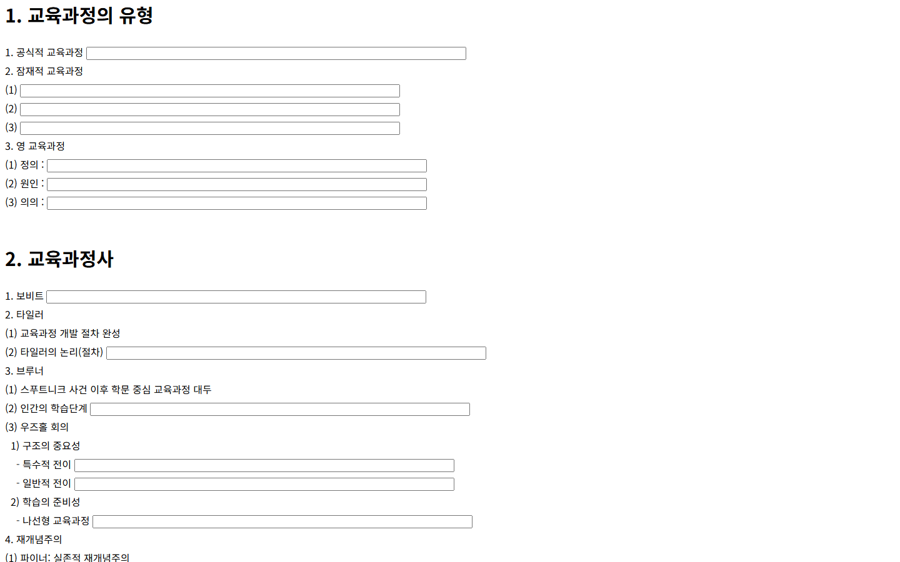

# 교육학 빈칸 노트 (html_pedagogy)

교육학의 교육과정과 교육심리 내용을 HTML 빈칸 노트로 정리하고, HTML을 연습하며 만든 작은 방명록 페이지를 함께 모아 둔 레포입니다. 개념의 뼈대만 적어 두고 내용은 빈칸에 직접 써 보며 익히는 방식입니다.

바로가기 (GitHub Pages)

- 교육과정: https://yhk1m.github.io/html_pedagogy/1.%20%EA%B5%90%EC%9C%A1%EA%B3%BC%EC%A0%95.html
- 교육심리: https://yhk1m.github.io/html_pedagogy/2.%20%EA%B5%90%EC%9C%A1%EC%8B%AC%EB%A6%AC.html
- 벚꽃제 방명록: https://yhk1m.github.io/html_pedagogy/%EB%B2%9A%EA%BD%83%EC%A0%9C%20%EB%B0%A9%EB%AA%85%EB%A1%9D.html

첫 화면(`index.html`)은 지워져 있어 레포 주소 `https://yhk1m.github.io/html_pedagogy/` 로 들어가면 404가 나옵니다. 위 주소로 파일을 바로 여세요.



## 할 수 있는 일

- **교육과정 노트**: 교육과정의 유형(공식적, 잠재적, 영 교육과정), 교육과정사(보비트, 타일러, 브루너, 재개념주의), 교육과정 개발 같은 항목 옆에 빈칸이 있어 직접 채워 봅니다.
- **교육심리 노트**: 발달(피아제, 비고츠키 등)을 비롯한 교육심리 항목을 같은 빈칸 방식으로 정리합니다.
- **벚꽃제 방명록**: 작성자, 비밀번호, 내용을 넣어 글을 올리고, 비밀번호로 고치거나 지우는 연습용 페이지입니다. 글은 저장되지 않아 페이지를 새로고침하면 사라집니다.

빈칸에 쓴 내용은 저장되지 않고, 정답 확인 기능도 없습니다.

## 여는 법

위 주소로 들어가거나, 내려받은 HTML 파일을 브라우저로 열면 됩니다. 다른 파일이나 인터넷 연결이 필요 없습니다.

## 파일 구성

```
html_pedagogy/
├── 1. 교육과정.html      # 교육과정 빈칸 노트
├── 2. 교육심리.html      # 교육심리 빈칸 노트
├── 벚꽃제 방명록.html     # 방명록 연습 페이지
└── docs/images/          # README 그림
```

## 만든 사람

양정고등학교 지리교사 김용현  
문의: bgnlkim@gmail.com
